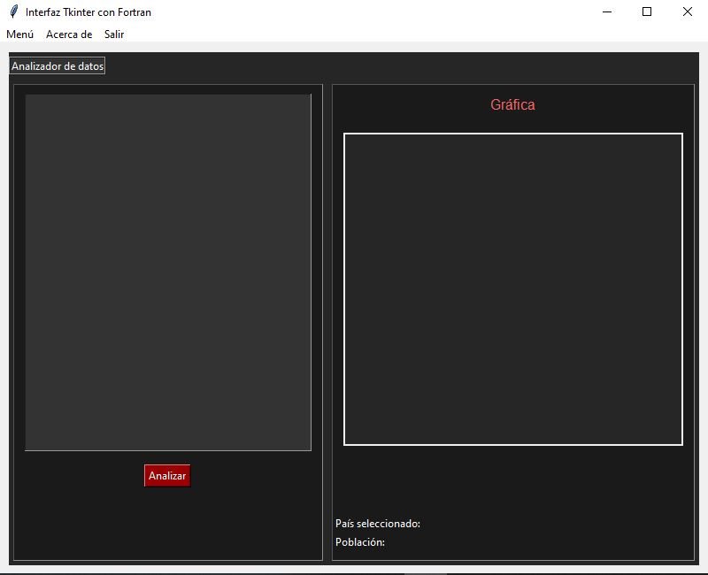
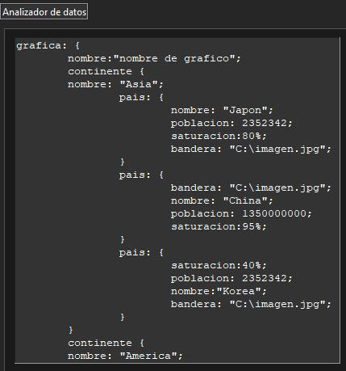
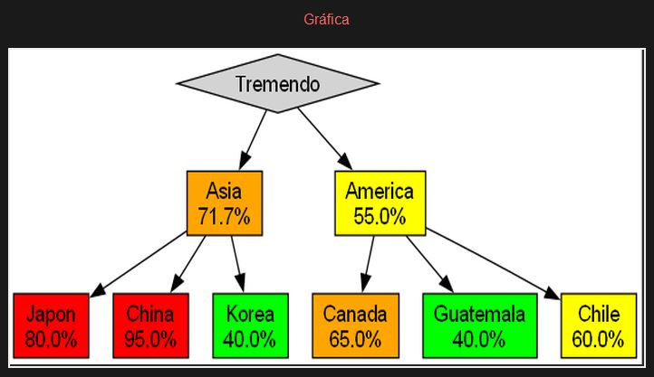
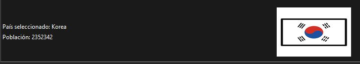

UNIVERSIDAD DE SAN CARLOS DE GUATEMALA

FACULTAD DE INGENIERIA

ESTRUCTURA DE DATOS

CATEDRÁTICO: ING. DAVID

========================================================================

  
  

    <h1 style="color: black; text-decoration: underline; text-decoration-color: black;" >MANUAL DE USUARIO</h1>
  

  

========================================================================

OTTONIEL FABRICIO VÁSQUEZ PINEDA
 
CARNÉ: 202307820
 
SECCIÓN B+

GUATEMALA 19 DE SEPTIEMBRE DEL 2024

========================================================================

<h2 align="center"> Introducción </h2>
En este proyecto es un sistema en la cual ayuda a los bancos en que lugar se puedan ubicar para ver si en ese lugar hay menos competencia de bancos y también te permitira subir archivos que tengan la extensión .ORG con la cual se podrá analizar tal archivo en que lugares hay menos saturación y trabajar mejor, no solo eso sino que al analizarlo les enseñara el pais y su población con su bandera donde hay menos saturación, también mostrará una grafica de todos los continentes con su saturación y sus paises igualmente con su saturación.

<h2 align="center"> Objetivos del sistema </h2>

### GENERAL
- Ayudar a los bancos a ubicarse en lugares con menos competencia.

### ESPECÍFICOS
- Analizar archivos con la extensión .ORG.
- Mostrar la ubicación del archivo en un mapa.
- Mostrar la información del país con la menor saturación.
- Mostrar la información del continente con la menor saturación.
- Mostrar una gráfica de los continentes con su saturación.
- Mostrar una gráfica de los países con su saturación.

<h2 align="center"> Requisitos del sistema </h2>

- Tener un archivo con la extensión .ORG.
- Tener instalado Python en tu computadora.
- Tener instalado Fortran
- Tener un ide para correr el programa

### Uso del programa
Al darle ejecutar al programa en phyton se le mostrara una interfaz que es la siguiente

=========================================================

Aquí como puede observar tiene varias cosas, en la cual tiene las diferentes opciones:
- **Menú** : en la cual este mostrara más opciones que serían
  - *Abrir*: que en esta parte se te abre una ventana para buscar el archivo que quieres analizar, recuerda que solo se aceptan archivos con la extensión .ORG.

  

  - *Guardar*: esta opción es donde se guarda el texto, si al principio no tiene archivo para guardar, se le pone un nombre y también se escoge el lugar donde guardarlo y si ya había uno guardado en el cual se había guardado un archivo antes, solo se le da guardar se guarda automáticamente pero siempre con la extensión de .ORG.

  - *Guardar como*: En esta parte est ambién para guardar el archivo, pero siempre que se le de a esta opción se guardara pero tendrás que ponerle nombre y el lugar donde quieres guardarlo, eso será siempre para esta opción y siempre se guardara con la extensión del archivo que sera .ORG.

- **Acerca de**: En esta opción se mostrará la información del creador, osea lo que se verá en la imagen

- **Salir**: En esta opción cabal como se dice su nombre significa salir, osea que se saldra de la aplicación y la cerrara.

- **Entrada para el analizador de datos**: Aquí es donde se subirá el archivo con la extensión .ORG osea el contenido o también se puede escribir lo que quieras que se analice.

-**Boton analizador**: Este boton es el que se encarga de mandar la información de la entrada del analizador de datos para que se pueda analizar la información de la entrada.

-**Area de gráfica**: En esta área se puede ver la gráfica que se hace al hacer al analizar los datos.

-**Area de selección**: En esta área se podrá ver el país que se selecciono y también su población con su respectiva bandera.

### Ejemplo del archivo .ORG tendría que ser como el siguiente para poder analizar cierto archivo:

